# Metorah — architecture and proofs

```mermaid
flowchart LR
    L[Original WASM application] --> F[Finalize irreversible freeze]
    F --> H[Finalized source block + trusted header]
    H --> I[Read storage proofs + reconcile all holders]
    I --> M[Canonical migration manifest]
    M --> R[Governed / verifiable root commitment]
    R --> T[Destination claim ledger]
    T --> C[One claim per entitlement index]
    C --> E[Balance and invariant reconciliation]
```

**Boundary:** Only the target ledger draft and earlier offline model are packaged. No on-chain freeze or source storage verification is implemented. The target contract's administrator is trusted when committing the Merkle root, so its claims do not prove source authenticity. Credits are bookkeeping entries, not real bridged/minted assets.

## First requirements for production-grade assurances
1. Source contract supports irreversible freeze.
2. Known holder enumeration with verified completeness (or explicit limitation).
3. Trusted finalized source header and storage proof verification.
4. New wallet destination binding using appropriate signature scheme.
5. Migration-specific Merkle claims, no replay, conservation and transparent failure remediation.
