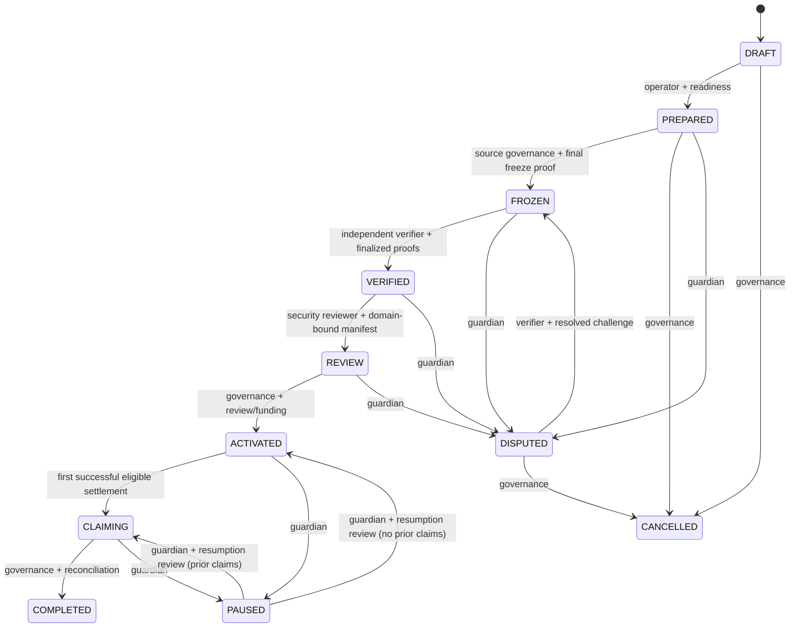

# Metorah migration lifecycle specification

**Specification v1 (issue #15), 2026-10-15.** This document and the local reference model are NOT a deployed migration, on-chain authorization, chain proof verification or an audit. All source/settlement evidence gates below are **required future independently authenticated inputs**. Never read a caller-supplied truthy flag as cryptographic evidence.

Related: [PRD](PRODUCT_REQUIREMENTS.md), [trust model](SECURITY_TRUST_MODEL.md), [compatibility](COMPATIBILITY.md), #18–#39, #45, #70–#74.

## 1. Authority model and state progression

**Important:** CANCELLED and COMPLETED are terminal; no state returns to an editable DRAFT after source freeze. DISPUTED is a preactivation evidentiary stop. PAUSED is postactivation suspension of *new* settlement only, never reversal or mutation of already-settled claims. Replacing a disputed manifest requires a new verified report/review cycle and its own immutable version; it cannot silently replace an activated root.

## 2. Transition specification

| From → To | Required role | Required verified guards | Required audit event |
| --- | --- | --- | --- |
| DRAFT → PREPARED | operator | `source_eligible`, `mapping_window_closed` | `MigrationPrepared` |
| DRAFT/PREPARED/DISPUTED → CANCELLED | governance | `no_settlement` and authorized cancellation | `MigrationCancelled` |
| PREPARED → FROZEN | source_governance | `freeze_finalized`, `source_retired`; source must no longer mutate value or beneficiaries | `SourceFrozen` |
| FROZEN → VERIFIED | verifier | `header_verified`, `trie_verified`, `holders_complete`, `bindings_verified` | `SnapshotVerified` |
| VERIFIED → REVIEW | security_reviewer | `manifest_domain_bound` | `ReviewStarted` |
| REVIEW → ACTIVATED | governance | `review_complete`, `backing_verified`, `disputes_cleared`, `source_retired` | `MigrationActivated` |
| PREPARED/FROZEN/VERIFIED/REVIEW → DISPUTED | guardian | explicit challenge/incident reference | `MigrationDisputed` |
| DISPUTED → FROZEN | verifier | `dispute_resolved`, `freeze_finalized`, `source_retired`; evidence must be reverified | `DisputeResolvedForReverification` |
| ACTIVATED/CLAIMING → PAUSED | guardian | documented incident authority, no root rewrite | `ClaimsPaused` |
| PAUSED → ACTIVATED/CLAIMING | guardian | `incident_resolved`, `backing_verified`, prior-claims consistency | `ClaimsResumed` |
| ACTIVATED/CLAIMING → CLAIMING | destination holder (claim action only) | authentic finalized activation; exact authenticated beneficiary, valid Merkle proof, unclaimed index, adequate backing | `EntitlementSettled` |
| CLAIMING → COMPLETED | governance | `claim_window_ended`, `liabilities_reconciled`; unclaimed rights policy applied | `MigrationCompleted` |

Roles above are trust **requirements**, not currently implemented wallet-based access controls. Real roles require chain-specific signatures, multisig/verified source transactions and/or reviewed service authorization (#22, #36–#37, #49, #79). A signed report is not proof of a finalized source state.

## 3. Immutable record and idempotency requirements

Every migration must be scoped to a unique canonical migration ID and freeze: source genesis, source contract/code and state schema, finalized checkpoint and storage root, asset units, source holder inventory and source-authenticated beneficiary mapping, destination chain and contract, manifest version/hash, approved funding and governance policy. After activation, changes require a **new, explicit migration**, not in-place root/beneficiary/amount edits.

Every transition and claim must persist an append-only event with actor identity/authorization evidence, event type, before/after state, operation ID, immutable manifest reference, observed chain transaction/block (only when real), time, correlation ID and failure reason if rejected. `request_id` retries must be idempotent **only for the exact same payload**; same ID with changed payload is an error. Client-supplied timestamps and status booleans are not evidence. Chain transaction/receipt is authoritative for settlement, with finality-specific confirmation before UI success (#48).

## 4. Formalized conservation and security properties

Let `S[a]` be the authentic frozen source entitlement for every eligible account `a`, and `D[i]=(owner, beneficiary, amount)` be each destination leaf.

1. **No silent omissions or duplicate rights:** the verified source holder set equals the destination holder set under canonical mapping; every positive source entitlement has exactly one indexed leaf, and no extra leaf exists.
2. **Value conservation:** `sum(S[a]) = sum(D[i].amount)` in well-defined smallest units (or explicitly reviewable deterministic conversion), before and after each settlement.
3. **No double-spend:** the old source's rights must be permanently retired/locked before any destination settlement. A transferable/upgradeable bypass after freeze invalidates activation.
4. **No duplicated claim:** for each (migration ID, leaf index), successful settlement count is zero or one; an invalid, reverted or duplicate transaction must not consume a legitimate entitlement.
5. **Solvency:** destination's legitimately owned escrow or minting authority can cover total outstanding liabilities. `sum(settled) <= sum(verified allocation)`; *backing-sufficient* cannot be based on a self-declared server field.
6. **No unauthorized redirection:** beneficiary must match source-authorized cutoff binding and immutable migration/chain/contract domain. A relayer or third-party caller cannot pick an arbitrary recipient.
7. **Freeze-before-claim:** no claim is possible in DRAFT, PREPARED, FROZEN, VERIFIED, REVIEW, DISPUTED, CANCELLED, PAUSED or COMPLETED.
8. **One-way activation:** once activated, root, allocation, beneficiary mapping, source reference and published verification mode cannot change by administrator override. Pause affects only future claims.
9. **Status truthfulness:** “verified” means independently validated finalized header+storage membership+entire inventory+freeze+mapping; an operator-selected Merkle root is insufficient.

## 5. Required failure behavior and irreversible operations

| Failure | Required response |
| --- | --- |
| Wrong genesis/chain, nonfinal block, conflicting RPC or reorg | Stop snapshot/root activation; rescan pinned valid finalized checkpoint only |
| Invalid root, invalid storage proof or wrong domain | Reject verification; enter DISPUTED; publish reproducible discrepancy |
| Omitted/duplicate holder or mismatched supply | Block at FROZEN/VERIFIED, require new full inventory and report |
| Missing/changed owner beneficiary | Stop before cutoff/activation; no admin reassignment |
| Insufficient escrow or invalid mint authority | Block activation and claims; reconcile actual token backing |
| Stuck or reverted claim | Leave index unclaimed, show real pending/failed receipt, allow safe retry |
| Reentrancy, replay, or third-party reroute | Revert without transferring or consuming original user entitlement |
| Incident after claims began | PAUSED, preserve immutable rights and previously completed settlement; investigate and safely resume |
| User disappears or claim window ends | Disclose governance-approved residual liability/unclaimed value policy; no silent confiscation |
| Production data/store loss | Restore and reconcile from authoritative chains, not optimistic API records |

## 6. Reference model and delivery boundaries

`tools/lifecycle/model.py` and `test/test_lifecycle.py` are a deterministic **offline reference model** for transition/claim logic; gate names are **synthetic test fixtures**, not authenticated state proofs. Do not route real settlement through this model. The later production implementation must connect this specification to independently verified Portaldot finality/storage proofs, actual wallet signatures, persistently authorized roles, immutable destination contracts, chain receipts and an audited backing adapter.

Issue #15 is complete when this state table, invariants, negative tests and safe failure outcomes are reviewed. It does not supersede #20–#29, #36–#39, #45, #70–#74.
